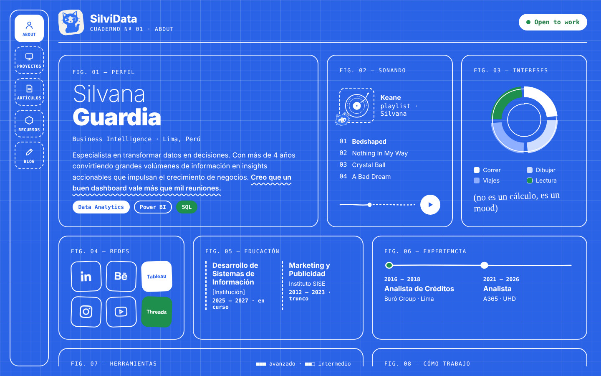

# SilviData · Portafolio

> Llegas por la curiosidad, te quedas por la historia.

Portafolio de **Silvi Data**, analista de Business Intelligence en Lima, Perú.
Aquí junto mis proyectos de análisis de datos, artículos, recursos y una bitácora de cómo trabajo.

🔗 **Ver en vivo:** [silvidata.github.io/nombre-del-repo](https://silvidata.github.io/nombre-del-repo/)



---

## ✏️ La idea

Quería un portafolio que se sintiera como abrir uno de mis cuadernos de trabajo, no como otra plantilla de dashboard oscuro.

- **Estética blueprint:** fondo azul con cuadrícula y líneas blancas, como un plano o un cuaderno técnico.
- **Bento con alma de dashboard:** cada sección es una "figura" del cuaderno (`FIG. 01 — PERFIL`, `FIG. 02 — SONANDO`…).
- **Gráficos dibujados a mano:** son decorativos y lo dicen sin vergüenza. *(no es un cálculo, es un mood)*
- **El gato de SilviData:** mi avatar y presentador del canal aparece como sticker en cada página, con un gesto distinto.

## 🗂️ Secciones

| Página | Qué hay |
|---|---|
| **About** | Perfil, experiencia, educación, herramientas, cómo trabajo, redes y una playlist |
| **Proyectos** | Proyectos de análisis aplicados a problemas reales de negocio, con filtros por tipo |
| **Proyecto abierto** | Caso de estudio: problema, solución, impacto estimado, lecciones aprendidas y stack |
| **Artículos** | Lo que aprendo investigando, explicado sin tecnicismos |
| **Recursos** | Plantillas, guías, canales con los que aprendí y herramientas de mi día a día |
| **Blog** | Bitácora: el detrás de cámaras de cada proyecto |

## 🛠️ Hecho con

- **HTML5** semántico
- **CSS3**: variables, Grid, Flexbox y tipografía fluida con `clamp()`
- **JavaScript** puro, mínimo, solo para los filtros de proyectos
- **Google Fonts**: Roboto, Roboto Mono y Caveat
- **SVG** para los bocetos y gráficos dibujados

Sin frameworks ni librerías: carga rápido y se puede leer de principio a fin.

## ✨ Detalles que cuidé

- **Responsive de verdad:** probado en escritorio, laptop, tablet y celular. En pantallas grandes el menú lateral queda fijo y el contenido hace scroll dentro de su caja; en celular el menú se vuelve una barra de íconos pegada arriba.
- **Accesible:** navegación con teclado, foco visible, textos alternativos en las imágenes y etiquetas para lectores de pantalla en los botones de solo ícono.
- **Ordenado:** todo lo visual vive en el CSS con clases; el HTML solo tiene contenido.
- **Fácil de crecer:** cada proyecto y artículo usa la misma estructura, así que agregar uno es copiar y editar.

## 📁 Estructura

```
silvidata-portafolio/
├── index.html               About
├── proyectos.html           Proyectos (con filtros)
├── proyecto-bitacora.html   Plantilla de caso de estudio
├── articulos.html           Artículos
├── articulo-sql-excel.html  Plantilla de artículo
├── recursos.html            Recursos
├── blog.html                Bitácora
├── css/
│   └── styles.css           Todo el diseño, organizado por secciones
├── js/
│   └── main.js              Filtros de proyectos
└── assets/
    ├── gatos/               Stickers del gato de SilviData
    └── iconos/              Íconos de redes
```

## 🚀 Verlo en tu compu

No necesita instalar nada:

1. Descarga o clona el repositorio.
   ```bash
   git clone https://github.com/tu-usuario/nombre-del-repo.git
   ```
2. Abre `index.html` en tu navegador.

## 🧩 Cómo editarlo

- **Colores y tipografías:** están como variables al inicio de `css/styles.css` (`--azul`, `--verde`, `--crema`…).
- **Agregar un proyecto:** en `proyectos.html`, copia un bloque `<article class="proyecto">`. Con `data-tipo="dashboard"` o `data-tipo="caso"` eliges en qué filtro aparece. Para su página, duplica `proyecto-bitacora.html`.
- **Agregar un artículo:** duplica `articulo-sql-excel.html` y enlázalo desde `articulos.html` o `blog.html`.

## 🌐 Publicarlo en GitHub Pages

1. Sube el contenido de esta carpeta a un repositorio de GitHub.
2. Entra a **Settings → Pages**.
3. En *Source* elige la rama `main` y la carpeta `/ (root)`, y guarda.
4. En unos minutos estará en `https://silvidata.github.io/nombre-del-repo/`.

## 📬 Contacto

- LinkedIn: [tu perfil](https://www.linkedin.com/company/103997061/admin/dashboard/)
- Behance: [tus proyectos creativos](https://www.behance.net/silvanaguardia)
- Tableau Public: [tus dashboards](https://public.tableau.com/app/profile/silvana.guardia/vizzes)

## ©️ Derechos

© 2026 Silvana Guardia. El código de este sitio es de referencia.
Las ilustraciones, el personaje del gato de SilviData y los textos son de mi autoría: no se pueden usar ni reproducir sin mi permiso.
